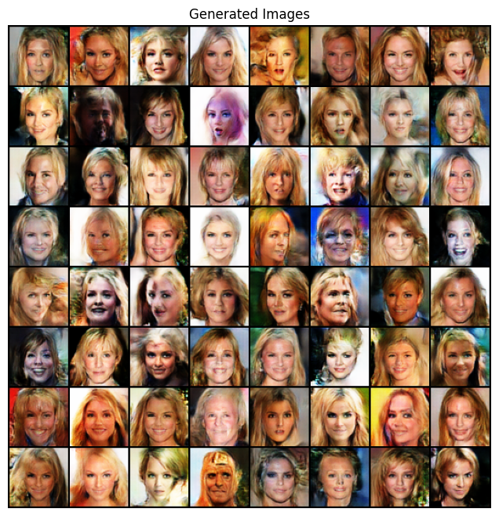
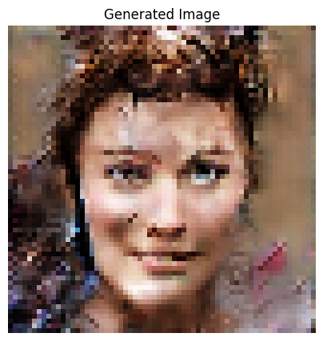

# Text-to-Face Generation with GANs

Generating 64×64 human face images from attributes and text descriptions using Generative Adversarial Networks (PyTorch), trained on CelebA-HQ.

This was my graduation project at the Faculty of Informatics Engineering (Artificial Intelligence), Tishreen University (2023–2024). The accompanying report documents ten iterative architecture versions and their results.



## Overview

The project compares two ways of conditioning a GAN on face descriptions:

1. **Attribute labels:** the condition is a binary vector (2 attributes, then all 40 CelebA attributes).
2. **Text embeddings:** attributes are turned into natural-language captions, encoded with BERT (768-d vectors), and used as the condition.

| Notebook | Condition | Main components |
|---|---|---|
| `notebooks/01_two_labels_cgan.ipynb` | 2 attributes (gender, black hair) | Conditional DCGAN, Categorical Conditional Batch Norm |
| `notebooks/02_forty_features_gan.ipynb` | all 40 CelebA attributes | Self-attention, spectral normalization |
| `notebooks/03_text_embeddings_gan.ipynb` | text captions → BERT embeddings (768-d) | Conditioning augmentation, text-to-attribute test helper |

## Data

- **Dataset:** CelebA-HQ (about 30,000 images) with the CelebAMask-HQ attribute annotations (40 binary attributes per image). [Download link](ADD_LINK_HERE)
- **Images:** resized to 64×64, pixel values normalized to [-1, 1].
- **Captions (text model):** 10 captions generated per image by randomly combining its attributes into sentences, then cleaned with regular expressions and encoded with BERT.

## Training setup

Values as configured in the notebooks:

| | 2 labels | 40 features | Text embeddings |
|---|---|---|---|
| Image size | 64×64 | 64×64 | 64×64 |
| Noise dimension | 100 | 100 | 100 |
| Batch size | 64 | 128 | 64 |
| Learning rate | 2e-4 | 2e-4 | 2e-4 |
| Optimizer | Adam (β₁ = 0.5) | Adam (β₁ = 0.5) | Adam (β₁ = 0.5) |
| Loss | BCE | BCE | BCE |

All models were trained on Google Colab, resuming from saved checkpoints across sessions.

## Results

Sample from the text-embedding model:



Qualitatively, the models learned the conditioned attributes (gender, hair colour) and the later versions produced sharper, more varied faces. The report contains the full training-loss table for all ten versions and side-by-side test outputs.

## Limitations

- **Resolution:** 64×64, limited by the free Colab GPU and memory.
- **Dataset bias:** CelebA-HQ is skewed toward young, light-skinned faces, and attributes such as "attractive" are unevenly distributed, which shows up in the outputs.
- **Text input:** attribute annotations are numeric, so text prompts are limited to the vocabulary the caption generator and the `text_to_list` helper cover.

## Future work

StyleGAN/ProGAN architectures, cosine similarity between input sentences and known labels, data augmentation, and a second super-resolution stage on top of the generated faces.

## How to run

The notebooks were written for Google Colab and use paths on Google Drive, so adjust the paths for your setup.

1. Download CelebA-HQ and the CelebAMask-HQ attribute annotation file.
2. Open a notebook in Colab, mount Google Drive and update the data and checkpoint paths.
3. Install the extra packages if needed: `pip install -r requirements.txt`.
4. Run the cells in order (data → model → training → test).

## Repository structure

```
.
├── README.md
├── notebooks/
│   ├── 01_two_labels_cgan.ipynb
│   ├── 02_forty_features_gan.ipynb
│   └── 03_text_embeddings_gan.ipynb
├── images/
├── requirements.txt
└── .gitignore
```

## Team

Graduation project completed by Farah Youssef, [Teammate 1] and [Teammate 2], supervised by [Supervisor].

**My contribution:** [one or two sentences, for example the parts you built and trained yourself].

## Tools

Python, PyTorch, torchvision, NumPy, pandas, Matplotlib, Hugging Face Transformers (BERT), Google Colab

## Author

**Farah Youssef** · [LinkedIn](https://linkedin.com/in/farah-yousef-66031a328)
